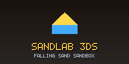
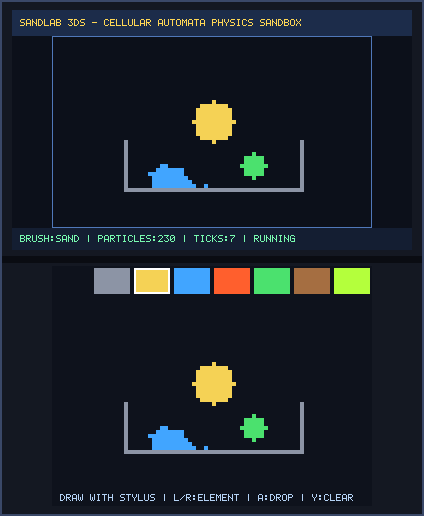
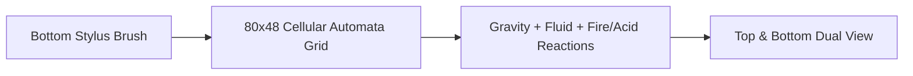

# SandLab 3DS (`3ds_sandlab`)

<p align="center">
  
  &nbsp;&nbsp;&nbsp;
  
</p>

<p align="center">
  
</p>

> **Falling Sand Physics Toy (`CTR-P-SAND`, UniqueId `0x0D3E9`)** — Part of the [**lafiabrew**](https://github.com/orgs/lafiabrew/repositories) Nintendo 3DS Homebrew Suite.

60 FPS Falling-Sand cellular automata physics sandbox supporting Stone Wall, Sand, Water, Fire, Plant, Oil, and Acid reactions.

---

## Architecture & Data Flow



---

## Controls & Touch Ergonomics

| Button / Input | Action |
|---|---|
| `Stylus Drag` | Paint active element onto the 80x48 physics canvas |
| `L` / `R` (or Tap Top Palette) | Select element (`Eraser`, `Wall`, `Sand`, `Water`, `Fire`, `Plant`, `Oil`, `Acid`) |
| `A` | Drop burst of particles at top center |
| `X` / `Y` | `X`: Pause/Resume physics | `Y`: Clear canvas |

---

## Build, Verify & Install

```bash
make test
make 3ds && make verify-3ds
make qr
```
